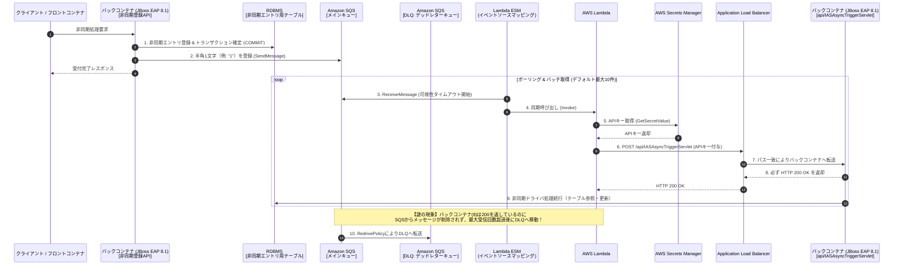
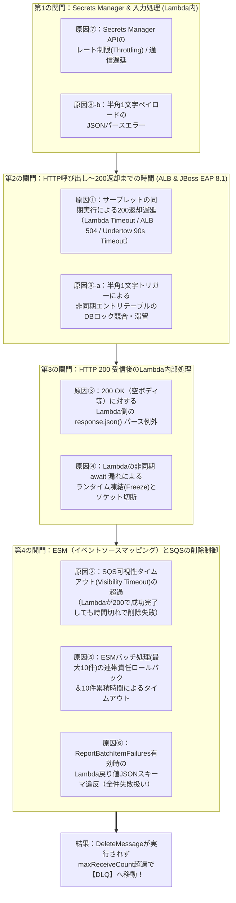

# ECS (UBI9.8 / JBoss EAP 8.1) + SQS + ESM + Lambda + ALB 非同期アーキテクチャにおける「HTTP 200返却にもかかわらずDLQへ送られる現象」の完全解剖ガイド

---

## 目次

1. [はじめに：本ドキュメントの目的と対象アーキテクチャ全体像](#1-はじめに本ドキュメントの目的と対象アーキテクチャ全体像)
2. [小学生にもわかる！「お仕事連絡ノートとピンポン玉リレー」で学ぶ仕組みと謎](#2-小学生にもわかるお仕事連絡ノートとピンポン玉リレーで学ぶ仕組みと謎)
3. [登場の歴史・背景・なぜこの構成が必要になったのか（技術進化の経緯）](#3-登場の歴史背景なぜこの構成が必要になったのか技術進化の経緯)
4. [【核心】バックコンテナが「必ず200を返す」のにDLQへ入る8大原因の徹底解剖](#4-核心バックコンテナが必ず200を返すのにdlqへ入る8大原因の徹底解剖)
5. [最新情報（AWS SQS ESM / Secrets Manager / UBI 9.8 / JBoss EAP 8.1）を踏まえた深掘り仕様](#5-最新情報aws-sqs-esm--secrets-manager--ubi-98--jboss-eap-81を踏まえた深掘り仕様)
6. [レイヤー別タイムアウト・パラメータ設計の黄金律（数値設計マトリクス）](#6-レイヤー別タイムアウトパラメータ設計の黄金律数値設計マトリクス)
7. [実践的な改善実装パターン（JBoss EAP 8.1 サーブレット ＆ Lambda 完全版コード）](#7-実践的な改善実装パターンjboss-eap-81-サーブレット--lambda-完全版コード)
8. [現場で即座に原因を特定するための最短切り分けチェックリスト](#8-現場で即座に原因を特定するための最短切り分けチェックリスト)

---

## 1. はじめに：本ドキュメントの目的と対象アーキテクチャ全体像

### 1.1 対象システムの構成整理

本システムは、AWS ECSタスク内に**フロントコンテナ**と**バックコンテナ（Red Hat UBI 9.8 + JBoss EAP 8.1 / Javaアプリケーション）**を配置し、時間のかかる業務処理を「DBテーブルへのエントリ登録 ＋ SQSへの半角1文字登録 ＋ Lambda/ALB経由のサーブレット起動」によって非同期実行するエンタープライズ構成です。



### 1.2 発生している「一見矛盾した現象」の本質

> **【疑問】**
> 「LambdaからALB経由で呼び出されるバックコンテナ（`api/IASAsyncTriggerServlet`）は**必ず HTTP 200 を返却している**。それなのに、なぜSQSメッセージが成功扱いにならず、**DLQ（デッドレターキュー）に追加されてしまうのか？**」

結論から言うと、**「バックコンテナが HTTP 200 を返したこと」と「SQSからメッセージが削除されること」の間には、少なくとも5つの関門（時間制限・バッチ連帯責任・レスポンス解釈・戻り値検証・インフラ制限）が存在するから**です。

**SQSメッセージがDLQへ行く唯一の条件**は、「バックコンテナがエラーを返したとき」ではなく、**「Lambdaのイベントソースマッピング（ESM）が、SQSの可視性タイムアウト（Visibility Timeout）が切れる前に、SQSに対して『DeleteMessage（削除命令）』を成功させられなかった回数が `maxReceiveCount`（最大受信回数）に達したとき」**です。

---

## 2. 小学生にもわかる！「お仕事連絡ノートとピンポン玉リレー」で学ぶ仕組みと謎

まずは専門用語をすべて学校の「お仕事リレー」に置き換えて、小学生でも直感的に「なぜそんなことが起きるのか」がわかるように説明します。

### 2.1 登場人物と役割のたとえ話

| システムの登場人物（専門用語） | 小学生向けのたとえ（給食・お仕事リレー） | どんな役割をしているの？ |
| :--- | :--- | :--- |
| **フロントコンテナ** | **クラスの窓口係** | みんなから「これやって！」と最初にお願いを聞く係です。 |
| **バックコンテナ (UBI9.8 / JBoss EAP 8.1)** | **裏の調理室のベテラン職人さん** | 頑丈なキッチン（UBI9.8）にある高性能調理マシン（JBoss EAP 8.1）を使って、実際にお仕事をする職人さんです。 |
| **非同期エントリ用のテーブル (DB)** | **「お仕事連絡ノート」** | やるべきお仕事の詳しい内容を書いておく、絶対に消えない大事なノートです。 |
| **半角1文字のSQS登録** | **「『あ』と1文字だけ書いたピンポン玉」** | ノートに書いたあと、「ノートに新しいお仕事を1個書いたよ！」と知らせるためだけに郵便受けに入れる合図の玉です。 |
| **Amazon SQS（メインキュー）** | **「合図のピンポン玉を入れる郵便受け」** | 職人さんへの合図のピンポン玉が順番に並ぶ箱です。 |
| **ESM (イベントソースマッピング)** | **「郵便受けの見張り番（仕分け係）」** | 郵便受けからピンポン玉を取り出して「配達員のLambdaくん」に渡し、**Lambdaくんが時間内に「無事終わったよ！」と報告してくれた時だけ、ピンポン玉をゴミ箱に捨てる（完了にする）**厳しい見張り番です。 |
| **AWS Lambda** | **「おつかい配達員のLambdaくん」** | 見張り番からピンポン玉をもらったら、金庫から合言葉を取り出して、裏の調理室へ「お仕事始めて！」と伝えに走る配達員です。 |
| **Secrets Manager** | **「秘密の合言葉（APIキー）が入った金庫」** | 関係ない人が勝手に調理室へ入れないように、Lambdaくんだけが取り出せる「合言葉カード」が入った金庫です。 |
| **ALB (ロードバランサー)** | **「校舎の案内係（受付のお姉さん）」** | 宛先が `api/IASAsyncTriggerServlet` だったら、「はい、裏の調理室の職人さんへどうぞ！」と道を繋いでくれる案内係です。 |
| **IASAsyncTriggerServlet (必ず200を返す)** | **「職人さんの『わかったよ！(200 OK)』という返事」** | Lambdaくんが合言葉を見せてノックしたら、職人さんが「よし、わかったよ！（200番＝OK）」と返事をして、連絡ノートを見ながら作業を続ける窓口です。 |
| **DLQ (デッドレターキュー)** | **「迷子・問題ありのピンポン玉を入れる調査箱（保健室）」** | 何回配達しても「完了報告」が戻ってこないピンポン玉を、「何かおかしいぞ！」とよけておく特別な箱です。 |

---

### 2.2 小学生にもわかる！「職人さんが『わかったよ！(200)』と言ったのに調査箱（DLQ）に入れられちゃう8つの理由」

「職人さんは毎回ちゃんと『わかったよ！（200 OK）』と返事をしているのに、どうして見張り番（ESM）はピンポン玉を捨てずに、調査箱（DLQ）に入れちゃうの？」
実は、そこには**8つのすれ違い（トリック）**があります！

1. **【トリック①：返事をするタイミングが遅すぎて、配達員（Lambdaくん）が途中で帰っちゃった！】**
   * 職人さんは「絶対に『わかったよ！(200)』と返事をする」と決めていますが、実は**連絡ノートのお仕事を全部終わらせてから**最後に「わかったよ！(200)」と言っていませんか？
   * お仕事に1分かかると、30秒しか待てない配達員（Lambdaくん）や案内係（ALB）は、「もう時間切れだ！失敗！」と途中で帰ってしまいます。職人さんは1分後に「わかったよ！(200)」と誰もいない廊下に向かって返事をするので、職人さんの記録には「200（成功）」と残りますが、見張り番は「失敗したな」と判定してしまいます。
2. **【トリック②：見張り番（SQS）の砂時計が先に落ちちゃった！（可視性タイムアウト切れ）】**
   * 配達員（Lambdaくん）は粘り強く待って、職人さんからちゃんと「わかったよ！(200)」という返事をもらって帰ってきました！
   * ところが、見張り番（SQS）が持っていた「30秒の砂時計（可視性タイムアウト）」が、Lambdaくんが戻ってくる前に落ちてしまっていました。砂時計が落ちると、見張り番は「Lambdaくんが途中で倒れたに違いない！」と思い込んで、同じピンポン玉をもう1回別の配達員に渡してしまいます。これが繰り返されると「何回やっても時間内に終わらない玉だ！」と調査箱（DLQ）に入れられてしまいます。
3. **【トリック③：職人さんの「わかったよ！(200)」のあと、Lambdaくんが「お手紙の中身が空っぽだ！」と転んでしまった！】**
   * 職人さんは「わかったよ！(200)」とだけ声をかけて、お返事の紙には何も書きませんでした（空っぽのボディ）。
   * ところがLambdaくんは「お返事の紙に詳しい報告書（JSON）が書いてあるはずだ！」と読もうとして、「あれっ、白紙で読めないぞ！（パースエラー）」と帰り道で転んで泣き出してしまいました。職人さんは「200」を返したのに、Lambdaくんが転んだせいで失敗になってしまいます。
4. **【トリック④：Lambdaくんが職人さんの返事を最後まで聞かずに部屋を出て凍結された！】**
   * Lambdaくんが「お仕事お願い！」と声をかけた瞬間、返事を最後まで待つ約束（`await`）を忘れて自分の部屋に戻って眠りについてしまいました（Lambdaのフリーズ）。あとから通信が切れてエラーになってしまいます。
5. **【トリック⑤：10個まとめ配達の「連帯責任」！（9個成功しても1個失敗したら10個ぜんぶやり直し）】**
   * 見張り番（ESM）は、ピンポン玉を1個ずつではなく、**最大10個まとめて**Lambdaくんに渡します。
   * 1個目〜9個目までは職人さんから「わかったよ！(200)」と返事をもらえましたが、10個目でつまずいた（または10個合計で時間切れになった）とします。すると見張り番は「10個セットの配達失敗！」と判断し、**すでに「200」をもらった1個目〜9個目のピンポン玉まで全部やり直し（最後はDLQ行き）**にしてしまいます！
6. **【トリック⑥：Lambdaくんから見張り番への「完了報告書の書き方」がルール違反だった！】**
   * 見張り番に「失敗した玉だけ報告するルール（`ReportBatchItemFailures`）」をお願いしていたのに、Lambdaくんが見張り番に「ステータス200、OKです！」と違う形式のメモを渡してしまいました。ルールに厳しい見張り番は「報告書の書き方が間違っている！全員やり直し！」と全部失敗にしてしまいます。
7. **【トリック⑦：秘密の金庫（Secrets Manager）に人が殺到して開かなかった！】**
   * ピンポン玉がたくさん届いたとき、何十人ものLambdaくんが毎回「秘密の金庫（Secrets Manager）」へ合言葉を取りに走りました。すると金庫の扉が混雑して「今は開けられません！（回数制限エラー）」と弾かれ、職人さんのところへ行く前や途中で失敗してしまいます。
8. **【トリック⑧：「『あ』と1文字しか書いていない玉」で職人さんたちが1冊の連絡ノートを取り合いになった！】**
   * ピンポン玉には「どのページのお仕事か」が書いておらず、ただ半角1文字（「1」など）しか書いてありません。そのため、10人のLambdaくんが同時に調理室をノックすると、10人の職人さんが**1冊のお仕事連絡ノートの同じページを一斉に奪い合い（DBのロック待ち）**になり、大渋滞が起きて時間切れになってしまいます。

---

## 3. 登場の歴史・背景・なぜこの構成が必要になったのか（技術進化の経緯）

なぜ現代のシステムでは、これほど多くのコンポーネント（ECS / UBI 9.8 / JBoss EAP 8.1 / 非同期テーブル / 半角1文字SQS / ESM / Lambda / Secrets Manager / ALB / DLQ）を組み合わせて非同期処理を作るのでしょうか？
それぞれの技術が**いつ・どのような課題を解決するために登場し、なぜこの設計に行き着いたのか**という歴史的背景を紐解くと、システム全体の意図と弱点が鮮明に見えてきます。

### 3.1 非同期処理とクラウドメッセージングの進化史（1990年代〜2026年）

| 年代・時期 | 登場した技術・出来事 | 当時の課題（なぜ必要になったのか） | 進化のポイントと現在への影響 |
| :--- | :--- | :--- | :--- |
| **1990年代後半〜2000年代前半** | **モノリシック同期HTTP処理 & J2EE (EJB / JMS)** | Webブラウザからのリクエストに対し、同じHTTPスレッド内で重いDB更新や外部連携を行うと、画面が固まり、アクセス集中時にAPサーバのスレッドが枯渇して全面停止（カスケード障害）していた。 | J2EEでJMS（Java Message Service）やMDB（Message-Driven Bean）が登場したが、専用ブローカー（ActiveMQ/MQ Series等）の構築・冗長化・永続化ストレージ管理が極めて重厚で高コストだった。 |
| **2004年11月 / 2006年** | **Amazon SQS の誕生（AWS史上最初のサービス）** | メッセージブローカー自体のサーバ管理・ディスク溢れ・クラスタ障害からエンジニアを解放し、インターネット越しに無制限かつ高可用にメッセージを緩衝（バッファリング）できる仕組みが求められた。 | 現在のクラウドネイティブ非同期処理の礎。あわせて「何度処理しても失敗する毒メッセージ（Poison Pill）がキューを塞ぐ問題」を解決するため、**DLQ（Dead-Letter Queue）とRedrive Policy**が導入された。 |
| **2014年11月** | **AWS Lambda の誕生** | キューを監視（ポーリング）するだけの常時起動ワーカーサーバ（EC2等）を24時間動かすと、アイドル時のコストとOS管理負荷が無駄になる課題があった。 | イベント駆動（Event-Driven）で必要な瞬間だけミリ秒単位でコードを実行するサーバーレスコンピューティングが確立された。 |
| **2018年6月** | **SQS × Lambda イベントソースマッピング (ESM) の登場** | 2018年以前は、SQSにメッセージが入ってもLambdaを直接起動できず、CloudWatch Events（現EventBridge）で1分ごとにLambdaを起動してポーリングさせる自作の仕組みが必要だった。 | AWSマネージドなポーラーである**ESM（Event Source Mapping）**が登場し、SQSの長輪詢（Long Polling）・バッチ取得・Lambda同期実行・成功時の自動 `DeleteMessage` をAWS側が代行する現在の標準構成が完成した。 |
| **2021年11月〜2025年** | **ESMの高度化（`ReportBatchItemFailures` / `MaximumConcurrency` / `EventCount`メトリクス）** | 初期のSQS ESMには「バッチ内1件失敗で10件全員ロールバックされる」「大量メッセージ流入時にLambdaが過剰スケールして下流DB/APサーバを破壊する」「ESM内部の削除・失敗挙動が見えない」という3大課題があった。 | ・**2021年11月**: `ReportBatchItemFailures`（部分バッチ成功）導入<br/>・**2023年1月**: `MaximumConcurrency`（ESM単位の最大同時実行数制限）導入<br/>・**2024〜2025年**: `Metrics=EventCount`（`PolledEventCount`, `DeletedEventCount`, `FailedInvokeEventCount` 等）によるESM内部の完全可視化が実現。 |

---

### 3.2 バックコンテナ基盤（Red Hat UBI 9.8 ＋ JBoss EAP 8.1）の歴史と背景

1. **JBoss AS から JBoss EAP 8.1（Jakarta EE 10）への進化**
   * 1999年にMarc Fleuryによって始まったJBossは、エンタープライズJavaのオープンソース標準となり、Red Hatによる商用サポート版**JBoss Enterprise Application Platform (EAP)** へと進化しました。
   * OracleからEclipse FoundationへJava EEが移管され、パッケージ名が `javax.*` から `jakarta.*` へと歴史的転換を遂げた **Jakarta EE 10** に完全準拠したのが **JBoss EAP 8.0（2024年2月GA）および JBoss EAP 8.1（2025年GA）** です。
   * JBoss EAP 8.1はJava SE 17 / 21 LTSをサポートし、超軽量・非同期I/OベースのWebサーバサブシステム **Undertow（Servlet 6.0対応）** を搭載しています。
   * **【重要な最新変更点】**: JBoss EAP 8.1ではセキュリティとリソース保護の観点から、UndertowのHTTP/HTTPS/AJPリスナーにおける **`read-timeout` および `write-timeout` のデフォルト値が従来の「無期限（`-1`）」から「`90000` ミリ秒（90秒）」に変更**されました。これが長時間接続時の挙動に大きく関わります。

2. **なぜコンテナOSに「UBI 9.8（Red Hat Universal Base Image 9.8）」を使うのか？**
   * かつてのコンテナ黎明期にはCentOSやAlpine Linuxが使われましたが、CentOSのサポート終了（CentOS Stream化）や、Alpine（musl libc）におけるJava JVMの互換性・性能問題、さらに金融・公共・基幹システムにおける**脆弱性管理（CVE対応）・FIPS暗号モジュール準拠・Red Hat公式サポート要件**から、RHEL 9.8と同一の信頼性を持つ再配布可能なコンテナベースイメージである **UBI 9.8** 上で **JBoss EAP 8.1** を動かす構成がエンタープライズ標準となりました。

---

### 3.3 なぜ「DB登録＆コミット後に半角1文字をSQSへ入れ、LambdaからALB経由でバックコンテナを叩き、必ず200を返す」設計になったのか？

この一見独特なアーキテクチャには、エンタープライズJavaシステムのクラウド移行・モダナイゼーションにおける**4つの明確な設計理由（背景）**があります。

1. **なぜ「非同期エントリ用テーブルに確定（COMMIT）した後」にSQSへ入れるのか？（分散トランザクション回避／Transactional Outboxの変形）**
   * RDBMS（データベース）とAmazon SQSの間では、2フェーズコミット（XAトランザクション）が使えません。
   * もしDBコミット前にSQSへメッセージを送ると、直後にLambdaが高速起動してバックコンテナを叩いた際、**「まだDBのトランザクションがコミットされておらず、非同期エントリ用テーブルを検索してもデータが見えない（ファントム空振り）」**という競合状態（Race Condition）が発生します。また、DBがロールバックされたのにSQSだけ飛んでしまう不整合も防ぐため、**「必ずDBトランザクションを確定させた後でSQSに登録する」**順序が必須となったのです。

2. **なぜSQSに「半角1文字」だけ登録するのか？（軽量キック／State-in-DBパターン）**
   * SQSには「1メッセージ最大256KBまで」というサイズ制限があります。また、業務データ（個人情報や機密データ）をSQSのメッセージ本文にそのまま載せると、クラウド上の複数箇所に機密データが複製されるセキュリティリスクや、データの二重管理（DBとSQSのどちらが正か）が生じます。
   * そこで、**「正確な業務データと処理ステータスはすべてDBの『非同期エントリ用テーブル』で一元管理し、SQSは『今、未処理データが1件増えたから非同期ドライバを1回起こして！（Wake-up Kick）』という合図（ベル）としてだけ使う」**という設計が採られました。SQSのメッセージ本文（Body）は空文字（`""`）にできない（最低1バイト必須というAWS SQS APIの仕様がある）ため、最小限の**「半角1文字（例：`"1"` や `"a"`）」**を送る設計が生まれました。

3. **なぜLambda自身で業務処理をせず、ALB経由でバックコンテナ（`api/IASAsyncTriggerServlet`）にPOSTするのか？**
   * 既存のJava資産（JBoss EAP 8.1上の複雑な業務ロジック、JTAトランザクション管理、JPA/Hibernate/MyBatis、データソースコネクションプール）をLambda用に別言語・別フレームワークで二重開発すると、保守コストが倍増しバグの温床になります。
   * また、Lambdaから直接RDBMSへ接続すると、スケールアウト時にDBコネクションが枯渇する問題や、Lambdaの最大15分制限に引っかかる問題があります。そのため、**「SQSのイベント検知とトリガー発火だけを軽量なLambdaに任せ、実際の業務処理（非同期ドライバ）は既存のバックコンテナ（JBoss EAP 8.1）内のサーブレットをALB経由で呼び出して実行させる」**というハイブリッド構成が選ばれました。
   * その際、内部API（`/api/IASAsyncTriggerServlet`）が外部や不正な通信から勝手に叩かれないよう、**Secrets ManagerからAPIキーを取得して認証する**仕組みが組み込まれました。

4. **なぜバックコンテナは「必ず200を返却する」仕様にしたのか？**
   * 業務データの状態管理（未処理・処理中・成功・業務エラー・再試行回数）は、すでにバックコンテナ側の「非同期エントリ用テーブル」と「非同期ドライバ」が責任を持って管理しています。
   * そのため、バックコンテナの設計者は**「トリガー用サーブレット（`IASAsyncTriggerServlet`）が呼ばれたら、業務エラーが起きようが起きまいがHTTPとしては常に `200 OK` を返してSQS/Lambda側のお役目を即座に完了させ、SQS側で勝手にリトライされないようにしよう」**と意図して「必ず200を返す」仕様にしました。
   * **しかし！その意図に反して、実際にはメッセージがDLQへ吸い込まれている**――これこそが今回解明すべき現象の核心です。

---

## 4. 【核心】バックコンテナが「必ず200を返す」のにDLQへ入る8大原因の徹底解剖

バックコンテナの `api/IASAsyncTriggerServlet` がコード上「必ず200を返す」ようになっていても、SQSのDLQにメッセージが送られてしまう原因は、以下の**8つのメカニズム**に分類されます。

### 全体俯瞰マップ（どこで失敗判定が起きているのか）



---

### 原因①：サーブレット（`IASAsyncTriggerServlet`）の「見かけ上の非同期（実質同期ブロック）」によるタイムアウト

* **現象のメカニズム**:
  「バックコンテナは必ず200を返却する。POSTを受け取った後で、非同期ドライバの処理を続行して非同期エントリ用のテーブルを参照し、更新する」という実装において、最も頻繁に発生する原因です。
  Jakarta Servlet（JBoss EAP 8.1 の Undertow）の `doPost(HttpServletRequest req, HttpServletResponse resp)` メソッド内で、以下のように書いていたとします：
  ```java
  // 【危険な実装例】ステータス200を先にセットしているが、同じスレッドで非同期ドライバを呼んでいる
  protected void doPost(HttpServletRequest req, HttpServletResponse resp) {
      resp.setStatus(HttpServletResponse.SC_OK); // 必ず200をセット
      try {
          asyncDriver.execute(); // ここで非同期エントリ用テーブルを参照・更新（数秒〜数十秒かかる）
      } catch (Exception e) {
          log.error("Async driver error", e);
          // 例外を握りつぶしてでも200を返す意図
      }
  }
  ```
  **ここが最大の罠です。**
  Servletの仕様上、`resp.setStatus(200)` を呼んだ瞬間には、まだクライアント（ALB → Lambda）へHTTPレスポンスの完了（ストリームの終端 EOF）は返りません！`doPost()` メソッドが最後まで実行し終わってUndertowのワーカースレッドから抜けた瞬間に初めて、HTTPレスポンスが完了します（仮に `resp.flushBuffer()` を先に呼んだとしても、`Transfer-Encoding: chunked` の終了チャンク `0\r\n\r\n` は `doPost()` 終了時まで送信されないため、LambdaのHTTPクライアントはレスポンス完了を待ち続けます）。
* **なぜ「200を返しているのにDLQに入る」のか？**:
  1. `asyncDriver.execute()` のDB参照・更新にたとえば **15秒** かかったとします。
  2. Lambdaのタイムアウト設定が **3秒（デフォルト）や10秒** だった場合、Lambdaは10秒時点で強制終了（`Task timed out`）し、ESMは「呼び出し失敗」と判定してSQSメッセージを削除しません。
  3. 一方、バックコンテナ（JBoss EAP 8.1）はクライアントが切断されたことに気づかず（あるいは処理完了まで走り切って）15秒目に `doPost()` を正常終了し、**JBoss EAPのアクセスログには堂々と `POST /api/IASAsyncTriggerServlet 200` と記録されます**！
  4. さらに処理が **60秒** を超えた場合は、ALBのアイドルタイムアウト（デフォルト60秒）が発動し、ALBがLambdaへ `504 Gateway Timeout` を返します（ALBのアクセスログを見ると `elb_status_code = 504`, `target_status_code = -` または遅れてバックコンテナ側だけ `200` になります）。
  5. さらに処理が **90秒** を超えた場合は、**JBoss EAP 8.1の新仕様であるUndertowの `read-timeout` / `write-timeout`（デフォルト90,000ms＝90秒）** に達してコネクションが切断されます。

---

### 原因②：SQS「可視性タイムアウト（Visibility Timeout）」の超過によるReceiptHandle失効と重複リトライ

* **現象のメカニズム**:
  「いや、Lambdaのタイムアウトは5分（300秒）に伸ばしてあるし、LambdaのCloudWatch Logsを見てもエラーは一切出ておらず、ALBからHTTP 200を受け取ってLambda自身も正常終了（`REPORT ... Status: success`）している！」という場合に起きる**最もステルス性の高い原因**です。
* **なぜ「Lambdaすら200を受け取って正常終了しているのにDLQに入る」のか？**:
  SQSの **可視性タイムアウト（Visibility Timeout：デフォルト30秒）** と、Lambdaの実処理時間の逆転現象です。
  1. たとえば、SQSの可視性タイムアウトがデフォルトの **30秒** のままだったとします。
  2. ESMがSQSからメッセージを取り出します（**1回目の受信：`ApproximateReceiveCount = 1`**）。この瞬間から30秒間のカウントダウンが始まります。
  3. Lambdaが起動し、Secrets ManagerからAPIキーを取り、ALBへPOSTし、バックコンテナが35秒かけて処理をして `HTTP 200` を返したとします。
  4. しかし、**30秒が経過した時点（Lambdaがまだ待っている最中）で、SQS側の砂時計（可視性タイムアウト）が切れます！**
  5. SQSは「30秒経っても削除命令（`DeleteMessage`）が来ないから、コンシューマが失敗したんだな」と判断し、そのメッセージを再びキューに戻します。
  6. すると直ちに別のESMポーラーがそのメッセージを取り出します（**2回目の受信：`ApproximateReceiveCount = 2`**）。この時点で、1回目のLambdaが持っていた引換券（`ReceiptHandle`）は無効化（または上書き）されます。
  7. 35秒目に1回目のLambdaが `HTTP 200` を受け取って意気揚々と終了しますが、すでに2回目の実行が始まっており、これが `maxReceiveCount`（例：3回）繰り返されると、**すべてのLambda実行が `HTTP 200` で成功しているにもかかわらず、メッセージはDLQへ送られます！**

---

### 原因③：HTTP 200 受信「直後」のLambda内レスポンスパース例外（空ボディ／非JSONの罠）

* **現象のメカニズム**:
  バックコンテナの `api/IASAsyncTriggerServlet` は「非同期処理をキックするためのサーブレット」であるため、ステータスコード `200` だけを返し、レスポンスボディは空（0バイト）か、`"OK"` といったプレーンテキストで実装されているケースが非常に多いです。
* **なぜ「200を返しているのにDLQに入る」のか？**:
  Lambda側のコードで、HTTPステータス200を確認した直後に以下のような処理を書いている場合です：
  ```python
  # 【危険な実装例】バックコンテナは200（ボディ空）を返しているのに .json() を呼んでいる
  response = requests.post(alb_url, headers={"x-api-key": api_key}, data=body)
  response.raise_for_status() # 200なのでここは通過する！
  result = response.json()    # ← ここで JSONDecodeError: Expecting value: line 1 column 1 (char 0) が発生！
  ```
  バックコンテナもALBも間違いなく `200 OK` を返していますが、Lambdaが最後の `.json()` で未キャッチ例外（Unhandled Exception）を投げてクラッシュするため、ESMは「Lambdaが異常終了した」と判定してメッセージを削除せず、`maxReceiveCount` 回リトライした後にDLQへ送ります。

---

### 原因④：Lambdaの非同期構文ミス（`await` 漏れ）によるランタイム凍結と通信中断

* **現象のメカニズム**:
  特に Node.js（JavaScript / TypeScript）や Python（`asyncio` / `aiohttp`）でLambdaを実装している場合に発生します。
  ```javascript
  // 【危険な実装例】async 関数内で fetch や axios の前に await を忘れている、または forEach 内で async を使っている
  export const handler = async (event) => {
      event.Records.forEach(async (record) => { // ← forEach は async の完了を待たない！
          const apiKey = await getSecret();
          await fetch(albUrl, { method: "POST", headers: { "x-api-key": apiKey } });
      });
      return; // ← リクエストが完了する前にハンドラが終了してしまう！
  };
  ```
* **なぜ「200を返しているのにDLQに入る」のか？**:
  Lambdaハンドラが `return` した瞬間、AWS Lambda実行環境（Firecracker MicroVM）はCPUとネットワークを**即座に凍結（Freeze）**します。バックコンテナにはリクエストが届いて `200` を返し始めますが、次回Lambdaが起動（Warm Start）して凍結が解けた瞬間に、前回の宙ぶらりんだったソケットがタイムアウトまたは `ECONNRESET` / `UnhandledPromiseRejection` を起こしてクラッシュし、そのバッチが失敗してDLQへ送られます。

---

### 原因⑤：ESMのバッチ処理（デフォルト最大10件）における「連帯責任ロールバック」と「累積時間の壁」

* **現象のメカニズム**:
  SQSのESM（イベントソースマッピング）は、デフォルトで **`BatchSize = 10`**（1回のLambda起動に最大10件のSQSメッセージを配列 `event.Records` として渡す）で動きます。
* **なぜ「200を返しているのにDLQに入る」のか？**:
  1. **【パターン5-A：累積時間の壁】**
     1メッセージあたりの処理（Secrets Manager取得 ＋ ALB POST ＋ バックコンテナ200返却）が **4秒** かかるとします。単体テストで1件送ったときは4秒で終わり、何の問題も起きません。
     しかし本番環境で10件まとめてバッチ取得されると、Lambda内で `for` ループを10回直列で回すため、`4秒 × 10件 = 40秒` かかります。するとLambdaのタイムアウト（例：30秒）やSQS可視性タイムアウト（30秒）を突破し、**1件目〜7件目まではバックコンテナが `200` を返したのに、8件目で時間切れになり、10件全員が失敗としてSQSへ戻され（最終的にDLQへ）**ます。
  2. **【パターン5-B：連帯責任（All-or-Nothing）ロールバック】**
     `ReportBatchItemFailures` を有効にしていない場合、バッチ内の10件のうち9件がバックコンテナから `200` を受け取って成功しても、残り1件が（たとえばSecrets Managerの一時的なスロットリング等で）例外を投げると、**バッチ全体が失敗扱いとなり、すでに200が返った9件も含めて全件がSQSから削除されず、リトライを繰り返してDLQへ落ちます**。

---

### 原因⑥：ESMの `ReportBatchItemFailures` 有効時における「戻り値フォーマット違反」

* **現象のメカニズム**:
  上記⑤を防ぐために、ESMの設定で **`ReportBatchItemFailures`（部分的なバッチ応答のレポート）** を有効化しているケースで多発する設定・実装ミスです。
* **なぜ「200を返しているのにDLQに入る」のか？**:
  AWS Lambdaの公式仕様により、ESMで `ReportBatchItemFailures` を有効にした場合、Lambdaが返すJSONは以下の構造に**完全一致**しなければなりません：
  ```json
  {
    "batchItemFailures": [
      { "itemIdentifier": "メッセージID (record.messageId)" }
    ]
  }
  ```
  もしLambdaのコードが、API Gateway用のテンプレートを流用して以下のような戻り値を返していたらどうなるでしょうか？
  ```python
  # 【危険な実装例】ReportBatchItemFailuresがONなのにAPI Gateway形式を返している、またはキー名が違う
  return {
      "statusCode": 200,
      "body": json.dumps("OK")
  }
  # または {"batchItemFailures": ["msg-id-1"]} のようにオブジェクトではなく文字列配列にしている
  # または itemIdentifier に messageId ではなく receiptHandle や空文字 "" を入れている
  ```
  このとき、AWSのESMはLambdaの戻り値を **「Invalid response format（不正なレスポンス形式）」** と判定し、**バックコンテナが全件200を返していようが、Lambda内でエラーが0件だろうが、問答無用で「バッチ全体の完全失敗」として扱い、すべてのメッセージをリトライ後にDLQへ送ります！**（非常に多くの現場がハマる落とし穴です）。

---

### 原因⑦：Secrets Manager APIの毎回呼び出しによるスロットリング（Rate Exceeded）とVPC通信遅延

* **現象のメカニズム**:
  本構成では「ESMを介してLambdaが起動して**APIキーをSecretsManagerから取得して**、ALBにPOSTで送信する」というフローになっています。
* **なぜ「200を返しているのにDLQに入る」のか？**:
  1. Lambdaハンドラの中（あるいは `for record in event.Records:` のループの中！）で、毎回 `secretsmanager.get_secret_value(SecretId=...)` を直接呼び出していると、10件バッチ×同時実行100個＝毎秒1,000回のAPIコールがSecrets Managerに集中します。
  2. するとSecrets Manager側で `ThrottlingException (Rate exceeded)` が発生します。
  3. また、ALBが内部ALB（Internal ALB）であるためにLambdaをVPC内に配置している場合、Secrets Manager用のVPCインターフェースエンドポイント（PrivateLink）やNAT Gatewayの帯域・コネクション上限、あるいはTLSハンドシェイク遅延により、Secrets Manager取得だけで数秒〜タイムアウトまで時間を浪費します。
  4. その結果、バックコンテナに到達したリクエストはすべて `200` を返しているにもかかわらず、一部のバッチやループ途中でSecrets Managerエラーまたは時間切れが発生し、DLQへ送られます。

---

### 原因⑧：「半角1文字のSQS登録」＋「非同期エントリテーブル参照・更新」設計特有のDB競合とパース罠

* **現象のメカニズム**:
  本アーキテクチャの最大の特徴である **「非同期エントリ用テーブルにデータ登録＆トランザクション確定後、半角1文字でSQSに登録」→「バックコンテナはPOSTを受け取った後で非同期ドライバの処理を続行して非同期エントリ用テーブルを参照・更新する」** という構造そのものに潜む3つの問題です。
* **なぜ「200を返しているのにDLQに入る」のか？**:
  1. **【8-a：非同期エントリ用テーブルへの一斉アクセスによるDBロック競合（Thundering Herd）】**
     SQSには「半角1文字（例：`"1"`）」しか入っていないため、「非同期エントリ用テーブルのどのレコード（主キー）を処理すべきか」という情報がリクエストに含まれていません。
     そのため、バックコンテナの非同期ドライバは、POSTを受け取るたびにテーブルに対して以下のようなクエリを発行します：
     ```sql
     SELECT * FROM async_entry_table WHERE status = 'WAITING' ORDER BY created_at ASC FOR UPDATE;
     ```
     もし短時間に50件の非同期要求が発生し、SQSに半角1文字が50個入ると、ESMはLambdaを並列起動し、ALB経由でバックコンテナの `api/IASAsyncTriggerServlet` に**50並列で同時にPOST**が飛びます！
     すると、JBoss EAP 8.1内の50本のスレッドが**同じテーブルの同じ未処理行（先頭行）を一斉に `SELECT ... FOR UPDATE` または `UPDATE` しようとして激しい行ロック待ち（Lock Wait）やデッドロック**を起こします（`FOR UPDATE SKIP LOCKED` を使っていない場合、49本のスレッドが1本目のトランザクション終了まで数珠つなぎで待たされます！）。
     さらにJBoss EAP 8.1のデータソース接続プール（例：`max-pool-size=20`）が枯渇し、21本目以降のリクエストはコネクション取得待ちでブロックされます。結果として、バックコンテナは最終的にすべて `200` を返すものの、後半のリクエストは応答までに数十秒かかってLambdaタイムアウト／SQS可視性タイムアウトを突破し、DLQへ大量流入します！
  2. **【8-b：「半角1文字」に対するJSONデシリアライズ罠】**
     もしSQSに登録する「半角1文字」が数字の `"1"` ではなく英字や記号（例：`"a"` や `"*"`）だった場合、Lambda側の共通ミドルウェアやロガー、あるいはコード内で `json.loads(record['body'])` / `JSON.parse(record.body)` を実行していると、`"1"` はJSONの数値としてパース成功しますが、ダブルクォートなしの `"a"` は `JSONDecodeError` で即死します。
  3. **【8-c：SQS FIFOキュー利用時の重複排除・グループブロッキング】**
     もしSQSにFIFOキューを採用し、「コンテンツベースの重複排除（ContentBasedDeduplication）」を有効にしていると、5分以内に送られた同じ「半角1文字（`"1"`）」はすべて重複とみなされて消滅します。逆に一意のDeduplicationIdを付けつつ同じ `MessageGroupId` にしていると、先頭1件がタイムアウトした瞬間に後続すべてのメッセージがブロックされ、連鎖的にDLQへ落ちます。

---

## 5. 最新情報（AWS SQS ESM / Secrets Manager / UBI 9.8 / JBoss EAP 8.1）を踏まえた深掘り仕様

2024年〜2026年時点の最新クラウド・ミドルウェア仕様を踏まえ、本構成で必ず押さえておくべき重要アップデートを整理します。

### 5.1 AWS Lambda SQS ESM（イベントソースマッピング）の最新仕様

1. **ESMのスケーリング速度と `MaximumConcurrency`（最大同時実行数制御）**
   * SQS（標準キュー）のESMは、初期状態で5並列からスタートし、キューにメッセージが滞留していると**1分間に最大60並列ずつ急速にスケールアウトし、最大1,250同時実行（最大12,500メッセージ同時処理）**まで拡大します。
   * バックコンテナ（ECS上のJBoss EAP 8.1）のサーバスレッド数やDBコネクションプール数は有限（数十〜百程度）であるため、ESMに無制限でスケールされるとバックコンテナが即座にパンクします。
   * **最新の解決策**: Lambda関数全体の予約済み同時実行数（Reserved Concurrency）ではなく、SQSのESM設定にある **`MaximumConcurrency`（最大同時実行数：2〜1,000の範囲で指定可能）** を設定し、バックコンテナ（JBoss EAP 8.1）が遅延なくさばける並列数（例：`2`〜`10`）に制限することが現在のAWS公式ベストプラクティスです。

2. **ESM拡張CloudWatchメトリクス（`Metrics=EventCount`）によるブラックボックス解消**
   * 従来、SQSからESMがメッセージを取り出してLambdaを叩き、削除するまでの内部動作はブラックボックスでした。
   * 最新のAWS Lambdaでは、ESMに `--metrics-config Metrics=EventCount` を有効化することで、以下の決定的なメトリクスをCloudWatchで直接観測できます：
     * `PolledEventCount`: ESMがSQSから取得したイベント数
     * `InvokedEventCount`: Lambdaを実際に呼び出したイベント数
     * `FailedInvokeEventCount`: Lambda呼び出しまたは戻り値検証に失敗したイベント数（←これが上がっていればLambda側エラーまたは `ReportBatchItemFailures` フォーマット違反！）
     * `DeletedEventCount`: 正常完了しSQSから削除されたイベント数（← `InvokedEventCount` よりこれが少なければ、削除されずにキューへ戻っている！）

### 5.2 AWS Parameters and Secrets Lambda Extension によるAPIキーキャッシュ

* Lambdaから毎回 `secretsmanager:GetSecretValue` を呼ぶ設計は、レイテンシ・コスト・スロットリングのすべてにおいてアンチパターンとなりました。
* 現在はAWS公式のLambdaレイヤーである **「AWS Parameters and Secrets Lambda Extension」** をアタッチするか、Lambdaの**グローバルスコープ（ハンドラ関数の外）でメモリキャッシュ（TTL付き）**することで、`localhost:2773` から数ミリ秒・APIコール0回でAPIキーを取得するのが標準です。

### 5.3 Red Hat UBI 9.8 ＋ JBoss EAP 8.1（Jakarta EE 10 / Undertow）の最新仕様

1. **Undertow リスナーのタイムアウトデフォルト値変更（無期限 `-1` → `90000ms`）**
   * JBoss EAP 7.x や 8.0 初期までは、UndertowのHTTP/HTTPSリスナーの `read-timeout` / `write-timeout` はデフォルトで `-1`（無制限）でした。
   * **JBoss EAP 8.1** からは、Slowloris攻撃対策やハングアップ接続の自動回収のため、デフォルト値が **`90000` ミリ秒（90秒）** に変更されています。したがって、サーブレット内で同期的に90秒以上かかる処理を行うと、Undertow側が強制的にソケットを閉じます。

2. **Jakarta EE 10 における正しい非同期実行（`ManagedExecutorService` / `@Asynchronous`）**
   * JBoss EAP 8.1（Jakarta EE 10）において、「POSTを受け取ったら即座にHTTP 200を返却してLambdaとの通信を完了させ、裏で非同期ドライバの処理を続行する」ためには、`doPost()` のスレッドでそのまま処理してはいけません。
   * Jakarta EE Concurrency 3.0 の **`@Resource ManagedExecutorService`** を使って別スレッドプールにタスクを投げ、**`doPost()` メソッド自体は数ミリ秒で `return` させる**ことで、Undertowが即座に `HTTP 200 OK` のレスポンスをコミット・クローズし、Lambdaが1秒未満で正常終了してSQSメッセージを確実に削除できるようになります。

---

## 6. レイヤー別タイムアウト・パラメータ設計の黄金律（数値設計マトリクス）

SQS + ESM + Lambda + ALB + JBoss EAP 8.1 の構成では、上流から下流までのタイムアウト値と並列度に**厳密な不等式（黄金律）**が成り立っていなければなりません。

### 6.1 タイムアウト不等式の黄金律

$$\text{SQS VisibilityTimeout} \ge 6 \times (\text{Lambda Timeout}) + \text{MaximumBatchingWindowInSeconds}$$

$$\text{ALB Idle Timeout} > \text{Lambda HTTP Client Timeout} > \text{JBoss EAP 8.1 サーブレット応答時間}$$

> **【最重要ポイント】**
> バックコンテナの `IASAsyncTriggerServlet` が「POSTを受け取って非同期ドライバをバックグラウンド起動するだけ」であれば、**サーブレットの応答時間は `10ms〜100ms`（0.1秒以下）** に収まります！これによりすべてのタイムアウト問題が根本から消滅します。

### 6.2 推奨設定値一覧表

| レイヤー / コンポーネント | パラメータ名 | 危険な設定（NG例） | 推奨設定値（ベストプラクティス） | 設定の根拠・理由 |
| :--- | :--- | :--- | :--- | :--- |
| **Amazon SQS (メインキュー)** | `VisibilityTimeout` (可視性タイムアウト) | `30秒` (デフォルトのまま) | **`180秒〜360秒`**<br/>(Lambda Timeoutの6倍以上) | Lambda実行中やESMリトライ中に可視性タイムアウトが切れて二重実行・ReceiptHandle失効になるのを確実に防ぐため。 |
| **Amazon SQS (メインキュー)** | `maxReceiveCount` (DLQへの最大受信回数) | `1回` または `2回` | **`3回〜5回`** | ネットワーク瞬断やコンテナデプロイ時の一時的な失敗で即座にDLQへ落ちるのを防ぎつつ、毒メッセージを隔離するため。 |
| **Amazon SQS (DLQ)** | `MessageRetentionPeriod` (保持期間) | `4日` (デフォルト) | **`14日 (1,209,600秒)`** (最大値) | 週末や大型連休を挟んで障害が発生しても、DLQ内のメッセージが自動消滅せず調査・再処理（Redrive）できるようにするため。 |
| **Lambda ESM (イベントソースマッピング)** | `BatchSize` (バッチサイズ) | `10` (1件の処理が重い状態で直列処理) | **`1`**（トリガー用途の場合）<br/>または **`5〜10`**（非同期即座返却化後） | 1件ごとにバックコンテナのドライバをキックする設計では、`BatchSize=1` にすることで連帯責任失敗と累積時間超過を完全に排除できる。 |
| **Lambda ESM** | `MaximumConcurrency` (最大同時実行数) | 未設定（最大1,250並列まで暴走） | **`2〜10`**<br/>(ECSタスク数×許容並列数に合わせる) | バックコンテナ（JBoss EAP 8.1）のスレッドプールおよびDBのロック競合・コネクション枯渇を防ぐ安全弁。 |
| **Lambda ESM** | `FunctionResponseTypes` | 有効なのにLambdaが不正JSONを返す | **`ReportBatchItemFailures`** を有効化し、正しいスキーマを返却 | バッチサイズ2以上の場合に、成功したメッセージ（200返却済み）が他の失敗メッセージの巻き添えでDLQへ行くのを防ぐ。 |
| **Lambda ESM** | `MetricsConfig` | 未設定 | **`Metrics=EventCount`** | `PolledEventCount`, `FailedInvokeEventCount`, `DeletedEventCount` を可視化し、どこで削除漏れが起きているか即座に特定する。 |
| **AWS Lambda** | `Timeout` (関数タイムアウト) | `3秒` (デフォルト) または `VisibilityTimeout` と同値 | **`30秒〜60秒`**<br/>(HTTP Client Timeout + バッファ) | コールドスタート＋Secrets Manager取得＋ALB通信リトライを含めても余裕で収まり、かつSQS可視性タイムアウトの1/6以下にする。 |
| **AWS Lambda** | Secrets Manager 取得方式 | ループ内で毎回 `get_secret_value()` | **グローバル変数キャッシュ** または **Parameters and Secrets Extension** | APIレート制限（Throttling）とVPC通信遅延（数100ms×件数）をゼロにする。 |
| **ALB** | `idle_timeout` (アイドルタイムアウト) | Lambda Timeoutより極端に短い／長い | **`60秒`**（デフォルト）<br/>※サーブレット即時返却なら1秒未満で完了 | サーブレットを非同期スレッド委譲型にすれば数十ミリ秒で200が返るため、60秒で十分安全。 |
| **バックコンテナ (JBoss EAP 8.1)** | `IASAsyncTriggerServlet` の実装方式 | `doPost` 内で同期的にドライバ処理を実行 | **`ManagedExecutorService` で別スレッドへ委譲し即座に `200` で `return`** | HTTPレスポンスをミリ秒単位で完了させ、Lambdaを即座に解放してSQSメッセージを確実に削除させる最善策。 |
| **バックコンテナ (DBクエリ)** | 非同期エントリテーブルの取得SQL | `SELECT ... FOR UPDATE` (ロック待ち発生) | **`SELECT ... FOR UPDATE SKIP LOCKED`** (または楽観ロック＋ステータス更新) | 複数のトリガーが同時に走っても、他のスレッドが処理中の行をスキップして待ち時間ゼロで次の未処理行を処理できるようにする。 |

---

## 7. 実践的な改善実装パターン（JBoss EAP 8.1 サーブレット ＆ Lambda 完全版コード）

「バックコンテナが200を返しているのにDLQへ入る」問題を**100%根絶する**ための、バックコンテナ側（Java / Jakarta EE 10 / JBoss EAP 8.1）とLambda側（Python 3.12）のリファレンス実装です。

### 7.1 バックコンテナ側：JBoss EAP 8.1 (`IASAsyncTriggerServlet.java`) の改善実装

**ポイント**:
1. `doPost()` のスレッド上で重い非同期ドライバ処理を直接実行せず、Jakarta EE 10 標準の `ManagedExecutorService`（JBoss EAP 8.1 管理下のスレッドプール）へ処理を委譲して、**数ミリ秒で `HTTP 200 OK` と明確なJSONボディ `{"status":"ACCEPTED"}` を返してメソッドを終了（`return`）**します。
2. 非同期ドライバ側では、複数並列で呼ばれてもロック待ちにならないよう `FOR UPDATE SKIP LOCKED`（または単一実行制御）を使用します。

```java
package com.example.ias.async.web;

import jakarta.annotation.Resource;
import jakarta.enterprise.concurrent.ManagedExecutorService;
import jakarta.inject.Inject;
import jakarta.servlet.ServletException;
import jakarta.servlet.annotation.WebServlet;
import jakarta.servlet.http.HttpServlet;
import jakarta.servlet.http.HttpServletRequest;
import jakarta.servlet.http.HttpServletResponse;
import java.io.IOException;
import java.io.PrintWriter;
import java.nio.charset.StandardCharsets;
import java.util.concurrent.RejectedExecutionException;
import org.jboss.logging.Logger;

@WebServlet(name = "IASAsyncTriggerServlet", urlPatterns = {"/api/IASAsyncTriggerServlet"})
public class IASAsyncTriggerServlet extends HttpServlet {

    private static final Logger LOG = Logger.getLogger(IASAsyncTriggerServlet.class);

    // JBoss EAP 8.1 (Jakarta EE 10) 標準の管理対象スレッドプールをインジェクション
    @Resource
    private ManagedExecutorService managedExecutorService;

    @Inject
    private IASAsyncDriverService asyncDriverService;

    @Override
    protected void doPost(HttpServletRequest request, HttpServletResponse response)
            throws ServletException, IOException {

        // 1. レスポンスヘッダとステータス200を確実に設定（Lambda側でパースエラーにならないようJSONを返す）
        response.setStatus(HttpServletResponse.SC_OK);
        response.setContentType("application/json");
        response.setCharacterEncoding(StandardCharsets.UTF_8.name());

        try {
            // 2. 非同期ドライバの処理は別スレッドへ即座に委譲し、HTTPスレッド（Undertow）をブロックしない！
            managedExecutorService.submit(() -> {
                try {
                    asyncDriverService.processPendingEntries();
                } catch (Throwable t) {
                    // バックグラウンド処理内の例外はここで確実にログ出力＆テーブルの状態更新を行う
                    LOG.error("Error occurred during async driver execution", t);
                }
            });
        } catch (RejectedExecutionException ree) {
            // スレッドプールが満杯の場合でも、すでに稼働中のワーカースレッドがテーブルを順次処理するか、
            // 仕様通り200を返してDBポーリング／次回トリガーに委ねる
            LOG.warn("Async driver thread pool is full; execution already in progress", ree);
        } catch (Throwable t) {
            LOG.error("Unexpected error submitting async driver task", t);
        }

        // 3. 明確なJSONボディを書き出してストリームをフラッシュし、ミリ秒単位でdoPostを終了する
        try (PrintWriter out = response.getWriter()) {
            out.write("{\"status\":\"OK\"}");
            out.flush();
        }
    }
}
```

---

### 7.2 AWS Lambda側：キャッシュ＋部分バッチ応答＋空ボディ安全処理 (`lambda_function.py`)

**ポイント**:
1. Secrets ManagerからのAPIキー取得を**グローバルスコープでメモリキャッシュ**し、スロットリングと通信遅延を防止します。
2. バックコンテナから `HTTP 200` が返った際、**ボディが空（0バイト）でもJSONパースエラー（`JSONDecodeError`）で自爆しない**ように安全にハンドリングします。
3. ESMの `ReportBatchItemFailures` の厳密なJSONスキーマ `{"batchItemFailures": [{"itemIdentifier": record["messageId"]}]}` を正確に返却します。

```python
import os
import time
import json
import logging
import urllib3
import boto3
from botocore.exceptions import ClientError

logger = logging.getLogger()
logger.setLevel(logging.INFO)

# コネクションプール再利用のためのHTTPクライアント（タイムアウトを明示設定）
http = urllib3.PoolManager(
    timeout=urllib3.Timeout(connect=3.0, read=10.0),
    retries=urllib3.Retry(total=0)  # リトライ制御はSQS/ESM側に一元化
)

secrets_client = boto3.client("secretsmanager")

# グローバルキャッシュ（Lambda実行環境のWarm Start時にAPIキーを再利用してスロットリングを防止）
_cached_api_key = None
_cache_expiry_time = 0.0
CACHE_TTL_SECONDS = 300  # 5分間キャッシュ

ALB_ENDPOINT_URL = os.environ.get("ALB_ENDPOINT_URL", "https://internal-alb.example.com/api/IASAsyncTriggerServlet")
SECRET_ID = os.environ.get("API_KEY_SECRET_ID", "prod/ias/async-api-key")


def get_api_key() -> str:
    """Secrets ManagerからAPIキーを取得（メモリキャッシュ付き）"""
    global _cached_api_key, _cache_expiry_time
    now = time.monotonic()
    if _cached_api_key is not None and now < _cache_expiry_time:
        return _cached_api_key

    response = secrets_client.get_secret_value(SecretId=SECRET_ID)
    secret_string = response.get("SecretString", "")
    try:
        # JSON形式で保存されている場合とプレーン文字列の場合の両方に対応
        parsed = json.loads(secret_string)
        api_key = parsed.get("apiKey") or parsed.get("api_key") or secret_string
    except (ValueError, TypeError):
        api_key = secret_string

    _cached_api_key = api_key
    _cache_expiry_time = now + CACHE_TTL_SECONDS
    return _cached_api_key


def lambda_handler(event, context):
    """
    SQS ESM トリガー用ハンドラ
    ReportBatchItemFailures に対応し、正しいスキーマで部分失敗のみを返却する
    """
    batch_item_failures = []
    records = event.get("Records", [])

    for record in records:
        message_id = record.get("messageId")
        # 注意: record.get("body") は半角1文字（例: "1" や "a"）なので json.loads() しない！
        raw_body = record.get("body", "1")

        try:
            api_key = get_api_key()

            headers = {
                "Content-Type": "text/plain; charset=utf-8",
                "X-API-Key": api_key,
            }

            response = http.request(
                "POST",
                ALB_ENDPOINT_URL,
                body=raw_body.encode("utf-8"),
                headers=headers,
            )

            # ステータスコードの確認（バックコンテナは200を返却する仕様）
            if 200 <= response.status < 300:
                # 【重要】バックコンテナが空ボディを返しても JSONDecodeError を起こさない！
                logger.info(
                    "Successfully triggered IASAsyncTriggerServlet: messageId=%s, status=%d",
                    message_id,
                    response.status,
                )
            else:
                # ALBが502/503/504等を返した場合は失敗として記録
                raise RuntimeError(
                    f"Unexpected HTTP status from ALB: status={response.status}, "
                    f"body={response.data.decode('utf-8', errors='replace')[:200]}"
                )

        except Exception as exc:
            logger.error("Failed to process SQS record: messageId=%s, error=%s", message_id, exc, exc_info=True)
            if message_id:
                # ReportBatchItemFailures の厳密なフォーマットに従って失敗メッセージIDを追加
                batch_item_failures.append({"itemIdentifier": message_id})

    # 必ず {"batchItemFailures": [...]} の形式で返却する
    return {"batchItemFailures": batch_item_failures}
```

---

## 8. 現場で即座に原因を特定するための最短切り分けチェックリスト

現在発生している事象が「8大原因のどれに該当するか」を5分以内に特定するための手順です。

| ステップ | 確認する場所・ログ・メトリクス | チェック内容（何を見るか） | 結果からわかる真犯人（原因番号） |
| :--- | :--- | :--- | :--- |
| **Step 1** | **LambdaのCloudWatch Logs**<br/>（`REPORT RequestId: ...` の行） | エラーログ（`[ERROR]`, `Traceback`, `SyntaxError`, `Task timed out`）が出ているか？また `Duration`（実行時間）は何ミリ秒か？ | ・`Task timed out` が出ている → **原因①（同期処理による遅延）** または **原因⑤（バッチ10件の累積時間超過）**<br/>・`JSONDecodeError` / `Unexpected end of JSON` → **原因③（200受信後の空ボディパースエラー）** または **原因⑧-b（半角1文字のパースエラー）**<br/>・`ThrottlingException (SecretsManager)` → **原因⑦（Secrets Manager制限）** |
| **Step 2** | **Lambdaログにエラーが1件もなく `Status: success` なのにDLQへ行く場合** | 1. SQSの `VisibilityTimeout`（秒）と Lambdaの `Duration`（秒）を比較<br/>2. ESMの `ReportBatchItemFailures` 設定と Lambdaの `return` 値を確認 | ・Lambda実行時間 ＞ SQS可視性タイムアウト → **原因②（可視性タイムアウト切れによる削除失敗）**<br/>・`ReportBatchItemFailures` がONで `return {"statusCode": 200}` 等を返している → **原因⑥（戻り値フォーマット違反による全件失敗扱い）** |
| **Step 3** | **ALBのアクセスログ**<br/>（S3出力ログ） | `/api/IASAsyncTriggerServlet` に対する `elb_status_code` と `target_status_code`、および `target_processing_time` を確認 | ・`elb_status_code = 504`, `target_status_code = -` → **原因①（バックコンテナが60秒以上応答せずALBが504切断し、後からバックコンテナが200を返した）**<br/>・`target_processing_time` が数秒〜数十秒と長い → **原因①** ＆ **原因⑧-a（DBロック待ち・コネクション枯渇）** |
| **Step 4** | **JBoss EAP 8.1 (バックコンテナ) のコードとログ** | `IASAsyncTriggerServlet` の `doPost` メソッドから `asyncDriver` を同じスレッドで呼んでいないか？DBでロック待ちが起きていないか？ | ・`doPost` 内で同期的にDB参照・更新を最後まで待ってからメソッドを抜けている → **原因①（見かけ上の非同期）** ＆ **原因⑧-a** |
| **Step 5** | **SQS ESMの拡張メトリクス**<br/>（`Metrics=EventCount`） | `PolledEventCount`, `InvokedEventCount`, `FailedInvokeEventCount`, `DeletedEventCount` の差分を確認 | ・`InvokedEventCount` に対して `FailedInvokeEventCount` が同数増加 → Lambda例外または **原因⑥（戻り値スキーマ不正）**<br/>・`FailedInvokeEventCount = 0` なのに `DeletedEventCount = 0` → **原因②（可視性タイムアウト超過による削除失敗）** |
